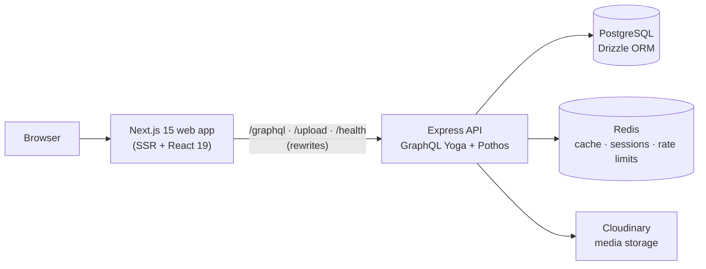

<div align="center">

# Pen Times Magazine

**A modern digital news platform for Katsina, Nigeria — reader site, author workflow and admin console in one system.**

[](https://github.com/umar-farouq360/pentimes/actions/workflows/ci.yml)


[**Live site → pentimes.ng**](https://pentimes.ng)

</div>

<!--
  Add screenshots here once you have them, e.g.:

  
  
  
-->

---

## Overview

Pen Times Magazine is a digital publication based in Katsina, Nigeria. This repository contains everything that runs it:

- a **public reading site** with categories, author pages, full-text search and a programmes schedule,
- an **author workflow** with a rich-text editor, drafts and cover-image uploads,
- an **admin console** for editors to manage articles, categories, comments, programmes and users, with analytics on users, articles and growth.

It was built end to end by a single developer (frontend, backend, infrastructure) and is live at [pentimes.ng](https://pentimes.ng).

## Features

**Readers**
- Browse by category and author, with SEO-friendly `sitemap.xml` and `robots.txt`
- Full-text search across the archive
- Like and comment on articles
- Personal dashboard with bookmarked articles, their comments and profile settings
- Programmes page showing the magazine's schedule

**Authors**
- Rich-text editor (Tiptap) with image uploads to Cloudinary
- Save drafts and publish when ready
- Author dashboard for managing their own articles

**Admins**
- Manage articles, categories, comments and programmes
- Manage users and roles (`reader`, `author`, `admin`)
- Analytics on users, articles and growth

**Platform**
- Argon2 password hashing, JWT access and refresh tokens in HttpOnly cookies, revocable per-device sessions
- Redis-backed caching and rate limiting
- Health endpoint that checks both PostgreSQL and Redis, structured JSON logs and graceful shutdown
- Docker images for the web app and API, plus backup and restore scripts

## Architecture



The web app and the API are separate deployable services. The browser only ever talks to the web app, which proxies `/graphql`, `/upload` and `/health` to the API. That keeps everything on one origin, which simplifies cookies and CORS.

### Key design decisions

| Decision | Why |
|---|---|
| **Separate Express + GraphQL API** instead of Next.js route handlers | A standalone API has its own scaling, security and caching story, and the same backend can serve other clients later. |
| **Code-first schema with Pothos** | Resolvers, types and the GraphQL schema stay in sync through TypeScript, with Relay-style pagination, typed errors and scope-based authorisation. |
| **PostgreSQL full-text search** (generated `tsvector` column + GIN index) | Good search with no extra service to run or keep in sync. |
| **Redis caching with targeted invalidation** | Article lists, single articles and search results are cached, and publishing or editing content invalidates the affected keys. |
| **Refresh tokens stored as hashes in Redis, per device** | A leaked cache or database doesn't expose usable tokens, and a single session or every session can be revoked (for example after a password change). |
| **Refresh tokens are deliberately not rotated** | Several tabs refreshing at once would look like token reuse and sign readers out. Revocation covers the theft case instead. |
| **Custom query-depth validation and introspection off in production** | Limits abusive or accidentally expensive GraphQL queries. |
| **Server-side upload checks** | Uploads are role-checked, validated on the server and stored under server-generated IDs, so clients never choose file names or paths. |
| **pnpm monorepo with a shared package** | The Zod schemas and types used by both the web app and the API live in one place. |

## Tech stack

| Layer | Technology |
|---|---|
| Frontend | Next.js 15 (App Router), React 19, TypeScript, Tailwind CSS, Tiptap |
| API | Node.js 20+, Express, GraphQL Yoga, Pothos, Zod |
| Database | PostgreSQL 16, Drizzle ORM and drizzle-kit migrations |
| Cache and sessions | Redis 7 (ioredis) |
| Auth | Argon2, JSON Web Tokens, HttpOnly cookies |
| Media | Cloudinary |
| Testing | Vitest, Playwright |
| Tooling | pnpm workspaces, Docker and Docker Compose, Nginx, GitHub Actions |
| Hosting | Railway |

## Repository structure

```
pentimes/
├── apps/
│   ├── web/                  # Next.js frontend
│   │   └── src/
│   │       ├── app/          # Routes: (public) · (auth) · (dashboard) · (admin)
│   │       ├── components/
│   │       ├── hooks/
│   │       ├── lib/
│   │       └── tests/        # unit (Vitest) and e2e (Playwright)
│   └── api/                  # Express + GraphQL API
│       └── src/
│           ├── graphql/      # builder, context, resolvers, plugins, error formatting
│           ├── services/     # auth, Redis, Cloudinary
│           ├── db/           # Drizzle schema, migrations, seed and admin scripts
│           ├── routes/       # REST routes (uploads)
│           └── middleware/
├── packages/
│   └── shared/               # Zod schemas and types shared by web and API
├── nginx/                    # Reverse-proxy config for self-hosting
├── scripts/                  # backup.sh · restore.sh
├── docker-compose.yml        # Local development stack
├── docker-compose.prod.yml   # Production-style stack (self-hosting)
└── DEPLOYMENT.md             # Self-hosting guide
```

## Getting started

### Prerequisites

- [Docker](https://docs.docker.com/get-docker/) with Docker Compose
- [Node.js](https://nodejs.org/) 20 or newer and [pnpm](https://pnpm.io/) 9 or newer (for the database scripts and local tooling)
- A free [Cloudinary](https://cloudinary.com/) account for image uploads

### 1. Clone and configure

```bash
git clone https://github.com/umar-farouq360/pentimes.git
cd pentimes
cp .env.example .env
```

Open `.env` and set at least the following (see [Environment variables](#environment-variables) for the full list):

```bash
# Generate two different secrets
node -e "console.log(require('crypto').randomBytes(64).toString('hex'))"
```

- `POSTGRES_PASSWORD`, and the same password inside `DATABASE_URL`
- `JWT_SECRET` and `JWT_REFRESH_SECRET` — two different values from the command above
- `CLOUDINARY_CLOUD_NAME`, `CLOUDINARY_API_KEY`, `CLOUDINARY_API_SECRET` and `NEXT_PUBLIC_CLOUDINARY_CLOUD_NAME`
- For local use, point the URL variables at localhost:

```bash
NEXT_PUBLIC_SITE_URL=http://localhost:3000
CORS_ORIGIN=http://localhost:3000
COOKIE_DOMAIN=localhost
COOKIE_SECURE=false
```

### 2. Start the stack

```bash
docker compose up --build
```

This starts PostgreSQL, Redis, the API and the web app with hot reload.

| Service | URL |
|---|---|
| Web app | http://localhost:3000 |
| GraphQL API | http://localhost:4000/graphql |
| Health check | http://localhost:4000/health |
| PostgreSQL (from your machine) | `localhost:5434` |

### 3. Set up the database

In a second terminal:

```bash
pnpm install
pnpm --filter shared build
pnpm db:migrate
```

Create your first admin account. The command prompts for the password with hidden input:

```bash
pnpm --filter api db:create-admin --email you@example.com --name "Your Name"
```

Admin passwords must be at least 12 characters. Public registration only ever creates `reader` accounts, which is why admins are created from the command line.

Optionally, load sample articles and users for development:

```bash
pnpm --filter api db:seed
```

> ⚠️ The seed script creates accounts with publicly known passwords. Use it for local development only, never in production.

Now open http://localhost:3000 and sign in at `/admin`.

## Environment variables

Copy `.env.example` for development and `.env.production.example` for production. Never commit the real files.

| Variable | Purpose |
|---|---|
| `NODE_ENV` | `development` or `production` |
| `API_PORT` / `WEB_PORT` | Ports for the API (default `4000`) and web app (default `3000`) |
| `POSTGRES_DB` / `POSTGRES_USER` / `POSTGRES_PASSWORD` | Database credentials used by the Postgres container |
| `DATABASE_URL` | PostgreSQL connection string (`localhost:5434` from your machine, the `postgres` service inside Docker) |
| `REDIS_URL` | Redis connection string |
| `REDIS_PASSWORD` | Required in production only |
| `JWT_SECRET` / `JWT_REFRESH_SECRET` | Signing secrets for access and refresh tokens. Use two different 64-byte hex values |
| `JWT_ACCESS_EXPIRY` / `JWT_REFRESH_EXPIRY` | Token lifetimes (defaults `15m` and `7d`) |
| `CLOUDINARY_CLOUD_NAME` / `CLOUDINARY_API_KEY` / `CLOUDINARY_API_SECRET` | Cloudinary credentials (server side) |
| `NEXT_PUBLIC_CLOUDINARY_CLOUD_NAME` | Cloudinary cloud name exposed to the browser |
| `NEXT_PUBLIC_SITE_URL` | Public URL of the site |
| `NEXT_PUBLIC_API_URL` | Public GraphQL URL. Baked in at build time, and overridden in the dev Compose file so the browser uses the web app's proxy |
| `CORS_ORIGIN` | Allowed browser origin for the API |
| `COOKIE_DOMAIN` / `COOKIE_SECURE` | Auth cookie settings. Use `COOKIE_SECURE=true` over HTTPS |

## Scripts

Run from the repository root.

| Command | What it does |
|---|---|
| `pnpm dev` | Run web and API in parallel without Docker |
| `pnpm build` | Build the shared package, then web and API |
| `pnpm typecheck` | Type-check shared, API and web |
| `pnpm lint` | Lint every workspace |
| `pnpm db:generate` | Generate a migration from schema changes |
| `pnpm db:migrate` | Apply migrations |
| `pnpm db:studio` | Open Drizzle Studio |
| `pnpm docker:dev` | Start the development stack |
| `pnpm docker:down` | Stop it |
| `pnpm docker:clean` | Stop it and delete all volumes |
| `pnpm docker:logs:api` / `pnpm docker:logs:web` | Follow service logs |

## Testing and CI

```bash
pnpm --filter web test     # unit tests (Vitest)
pnpm typecheck             # TypeScript across all packages
```

Playwright end-to-end tests live in `apps/web/src/tests/e2e`.

GitHub Actions runs type-checking, the web unit tests and a full build on every push. See [`.github/workflows/ci.yml`](.github/workflows/ci.yml).

## Deployment

The live site runs on [Railway](https://railway.app).

The repository also includes a self-hosting setup with `docker-compose.prod.yml`, an Nginx reverse proxy and backup and restore scripts. See [DEPLOYMENT.md](DEPLOYMENT.md) for the step-by-step guide.

For any production deployment:

- use strong, unique values for every secret and keep `.env.production` out of version control,
- set `COOKIE_SECURE=true` and serve the site over HTTPS,
- create the first admin with `db:create-admin`, never the seed script.

## Contributing

This is a client project, so outside contributions aren't expected. If you spot a bug or a security issue, please open an issue or email the maintainer rather than posting details publicly.

## About

Built by [Umar Farouq](https://github.com/umar-farouq360) as sole developer: product design, frontend, backend and infrastructure, for Pen Times Magazine.
